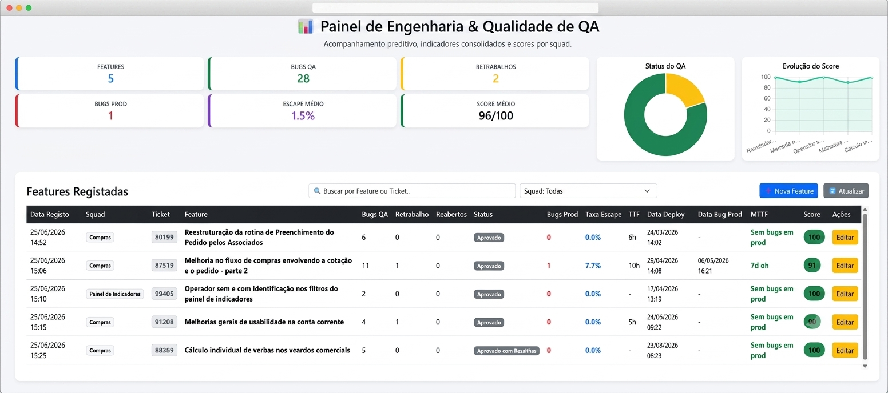

# 📊 Painel de Engenharia & Qualidade de QA

Um ecossistema completo de governança e análise de indicadores de testes, construído de forma nativa e integrada ao ecossistema Google Workspace (Google Sheets + Google Apps Script) com interface analítica em Bootstrap 5 e Chart.js.

O sistema separa de forma segura os privilégios de acesso: disponibiliza uma visão administrativa protegida por token para o analista de QA registrar as métricas e uma visão executiva limpa (View-Only) para a diretoria acompanhar os resultados sem risco de alteração de dados.

---

## 🚀 Funcionalidades Chave

* **Dashboard em Tempo Real:** Indicadores consolidados de features entregues, volumes de bugs capturados em ambiente de desenvolvimento (Pré-Prod), retrabalhos e falhas em produção.
* **Gráficos Dinâmicos (Chart.js):** Distribuição percentual do status das entregas (pizza) e linha de tendência histórica da evolução da qualidade (linha).
* **Filtros Avançados Instantâneos:** Busca em tempo real por nome da funcionalidade, código identificador do ticket (ex: Jira) e segregação de métricas por Squads e período de datas (Mês, Trimestre/Q1, Sprint).
* **Segurança Baseada em Token no Servidor:** Bloqueio direto na API do Google Apps Script que impede o carregamento de componentes de edição caso a URL de acesso não possua a chave secreta de administração.

---

## 📈 Lógica e Fórmulas de Engenharia de QA

O painel utiliza as melhores práticas de mercado para traduzir a saúde das entregas em dados matemáticos:

### 1. Taxa de Escape (Defect Leakage Rate)
Mede o percentual de problemas que escaparam do ambiente de testes e foram descobertos pelo cliente final:
$$Taxa\ de\ Escape = \left(\frac{Bugs\ em\ Produção}{Bugs\ QA + Retrabalho + Reabertos + Bugs\ em\ Produção}\right) \times 100$$

### 2. MTTF (Mean Time to Failure)
Intervalo de tempo corrido entre o momento do deploy em ambiente produtivo e o registro da primeira falha crítica na feature.

### 3. Score de Qualidade Ponderado (0 a 100)
Para evitar penalizar o time por retrabalhos saudáveis ocorridos de forma controlada dentro do ciclo interno de testes, o score avalia estritamente a eficácia da contenção do QA antes de chegar ao usuário:
* Se a funcionalidade for para produção estável com **0 defeitos**, o Score é **100**.
* Se houver escapes, o score diminui proporcionalmente ao impacto gerado:
$$Score = \max\left(0, 1 - \frac{Bugs\ em\ Produção}{Bugs\ QA}\right) \times 100$$

---

## 🛠️ Tecnologias Utilizadas

* **Frontend:** HTML5, CSS3, JavaScript (ES6+), Bootstrap 5 (UI Responsiva), Chart.js (Renderização gráfica).
* **Backend:** Google Apps Script (V8 Engine).
* **Banco de Dados / Armazenamento:** Google Sheets API.

---

## 🔧 Como Inserir no seu Google Drive

1. Crie uma nova **Planilha Google**.
2. Defina os cabeçalhos da primeira linha exatamente nesta ordem (da Coluna A até a P):
   > `Data Registo` | `Nome da Feature` | `Bugs QA` | `Retrabalho de Bugs` | `Bugs Reabertos` | `Status do QA` | `Observações` | `Bugs Produção` | `Taxa Escape` | `TTF` | `Data Bug Prod` | `Data Deploy` | `MTTF` | `Score` | `Squad` | `Ticket`
3. Vá no menu superior, clique em **Extensões > Apps Script**.
4. Crie dois arquivos no ambiente de desenvolvimento do Google:
   * Um arquivo de script chamado `Código.gs`
   * Um arquivo HTML chamado `Index.html`
   * Um arquivo HTML chamado `Visualizacao.html`
5. Cole os códigos respectivos salvos neste repositório.
6. Configure sua variável global de token no `Código.gs` e substitua o ID da sua planilha na função `obterMetricas` e `salvarDados`.

---

## 🌐 Realizando o Deploy Seguro

1. No canto superior direito do Google Apps Script, clique em **Implementar > Nova implementação**.
2. Selecione o tipo de engrenagem como **Aplicação Web**.
3. Defina as configurações cruciais de segurança:
   * **Executar como:** `Eu (seu-email@empresa.com)` *(Evita o aviso de "App não verificado" do Google para o seu gestor).*
   * **Quem tem acesso:** `Qualquer pessoa` ou `Qualquer pessoa com conta Google`.
4. Clique em **Implementar** e copie a URL gerada (Link de Produção).

### 🔑 Gerenciamento de Links:
* **Seu link de acesso (Admin - Permite criar/editar):** Adicione o token configurado no final do link.
  * *Exemplo:* `https://script.google.com/.../exec?token=seu_token_aqui`
* **Link da Diretoria (Apenas Visualização):** Envie o link limpo, sem nenhum parâmetro.
  * *Exemplo:* `https://script.google.com/.../exec`

---
Desenvolvido com foco na maturidade de processos e visibilidade analítica de qualidade de software.
